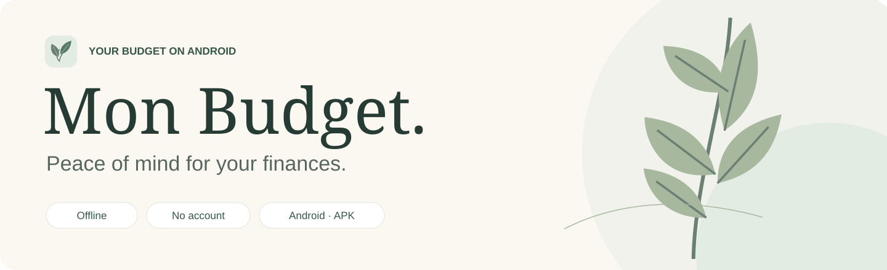
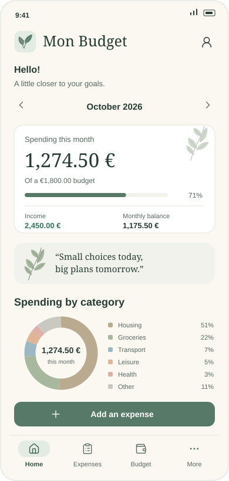
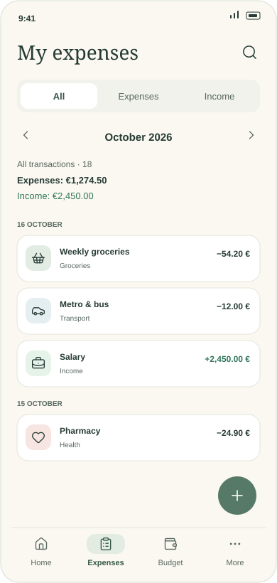
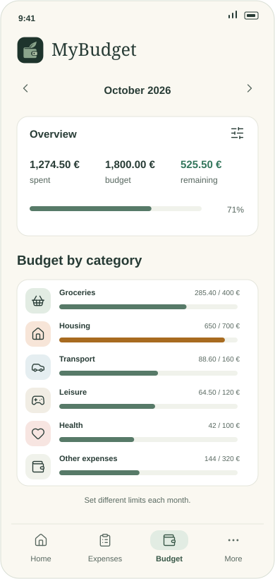
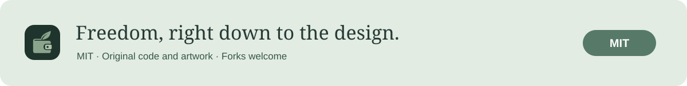

<p align="center"><a href="README.md">Français</a> · English</p>

<p align="center">
  
</p>

<p align="center">
  Everyday budgeting on your Android phone.<br />
  <strong>Your finances stay on your phone.</strong>
</p>

<p align="center">
  <a href="https://github.com/Azouriss/MyBudget/releases"><strong>Download the APK from Releases</strong></a>
</p>

## Previews

<p align="center">
  
  
  
</p>

<p align="center"><sub>SVG illustrations translated into English · fictional data · not screenshots. The app interface is currently in French, with amounts in euros.</sub></p>

| Your everyday needs | In MyBudget |
| :--- | :--- |
| Track | Expenses, income, search and a monthly overview. |
| Plan | An overall budget and limits per category. |
| Look ahead | Recurring expenses and local payday reminders on Android. |
| Stay in control | No account, backend or telemetry. Local SQLite storage. |

## Install on your phone

Each published release includes an **`.apk` file**, ready to install.
You do not need an Expo account, Node.js or a computer to use the app.

1. Open [Releases](https://github.com/Azouriss/MyBudget/releases) and download the APK under **Assets**.
2. Open the file on your phone; allow installation from this source if Android asks.
3. Launch **MyBudget**. The app then works offline.

**Updates:** install the new APK over the existing app, without uninstalling it,
to keep your data.

## Supported platforms

| Platform | Availability |
| :--- | :--- |
| Android phone | Primary platform · Android **7.0+** (API 24) · locally built APK for 32-bit and 64-bit ARM. |
| iPhone / iPad | Not supported. |
| Windows / macOS / Linux | Web preview for development; no desktop app is distributed. |

The minimum Android version comes from the build configuration. Each release's
notes should specify which devices were actually tested.

<details>
<summary>Develop, test and build</summary>

**Node.js ≥ 22.13 · npm**

```sh
npm ci
npm start
```

Use Expo Go compatible with SDK 57 or an Android emulator.
`npm run web` opens the development preview on your computer: its database is
separate from the one on your phone. When using WSL with Windows dependencies,
run npm from Windows PowerShell.

```sh
npm run check
npm run release:check
npm run build:android:local
```

Local builds require Windows, JDK 17 and the appropriate Android SDK.
The signed APK is produced in `dist/`. Keep `credentials.json`, the signing key
and the build state in `signing/` private.
Attach the APK and its `.sha256` file to every published release.

To update an existing installation, keep the same Android application ID and
signing key, increase the internal version number and test installing over the
previous APK without uninstalling. Verify that data is preserved.

</details>

**Backup:** save a complete JSON file from Settings before changing phones.
Restoring replaces local data after confirmation, requires the same data schema,
and disables reminders until you enable them again on the phone. CSV files are
for viewing or importing transactions, not full backups. Exported files are
unencrypted; keep them in a private location. Imports are limited to 8 MB and
1,000 transactions per CSV. No automatic remote backup is performed.

Settings also includes entry favorites, pay-to-pay budgets, split transactions,
partial reimbursements, monthly comparisons, renewal reminders, and CSV import
with previews, local category rules and duplicate checks.

Uninstalling the app or clearing
its data deletes the local database.

<sub>Expo SDK 57 · React Native · TypeScript · SQLite / Drizzle · NativeWind</sub>

## License

<a href="LICENSE"></a>

See the [MIT license](LICENSE).
[Third-party fonts, icons and dependencies](THIRD_PARTY_NOTICES.md) retain their own licenses.

**Security:** to report a vulnerability privately, see [SECURITY.md](SECURITY.md).
