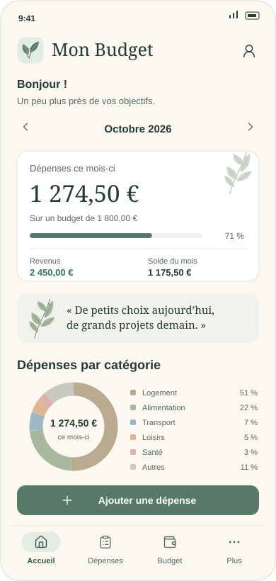
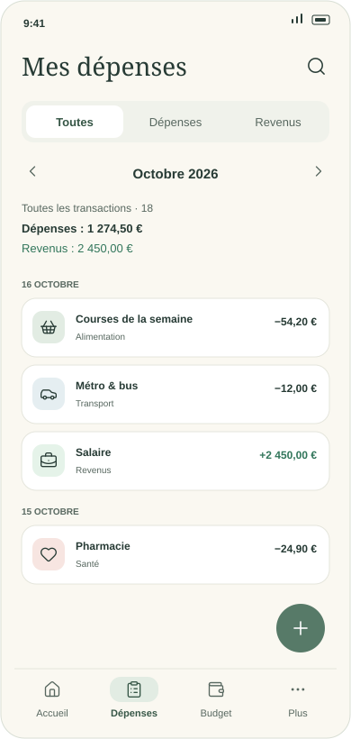
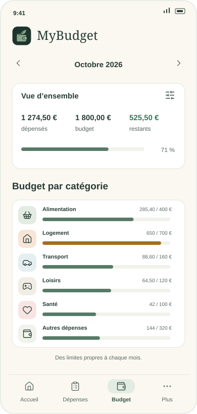

<p align="center">Français · <a href="README.en.md">English</a></p>

<p align="center">
  
</p>

<p align="center">
  Votre budget au quotidien, sur votre téléphone Android.<br />
  <strong>Vos finances restent sur votre téléphone.</strong>
</p>

<p align="center">
  <a href="https://github.com/Azouriss/MyBudget/releases"><strong>Télécharger l’APK dans les Releases</strong></a>
</p>

## Aperçus

<p align="center">
  
  
  
</p>

<p align="center"><sub>Aperçus illustrés en SVG · données fictives · ce ne sont pas des captures d’écran.</sub></p>

| Votre quotidien | Dans MyBudget |
| :--- | :--- |
| Suivre | Dépenses, revenus, recherche et bilan mensuel. |
| Prévoir | Budget global et limites par catégorie. |
| Anticiper | Dépenses récurrentes et rappel local du jour de paie sur Android. |
| Garder la main | Sans compte, sans backend, sans télémétrie. Données SQLite locales. |

## Installer sur son téléphone

Chaque release publiée contient un **fichier `.apk`**, prêt à installer.
Aucun compte Expo, Node.js ou ordinateur n’est nécessaire pour utiliser l’application.

1. Ouvrir les [Releases](https://github.com/Azouriss/MyBudget/releases) et télécharger l’APK dans **Assets**.
2. Ouvrir le fichier sur le téléphone ; autoriser l’installation depuis cette source si Android le demande.
3. Lancer **MyBudget**. L’application fonctionne ensuite hors ligne.

**Mise à jour :** installer le nouvel APK par-dessus l’ancien, sans désinstaller,
pour conserver les données.

## Supports

| Support | Disponibilité |
| :--- | :--- |
| Téléphone Android | Cible principale · Android **7.0+** (API 24) · APK local ARM 32 et 64 bits. |
| iPhone / iPad | Non pris en charge. |
| Windows / macOS / Linux | Aperçu web pour le développement ; aucune application de bureau distribuée. |

Le minimum Android provient de la configuration de compilation. Les appareils
effectivement testés sont à préciser dans les notes de chaque release.

<details>
<summary>Développer, tester et compiler</summary>

**Node.js ≥ 22.13 · npm**

```sh
npm ci
npm start
```

Utiliser Expo Go compatible SDK 57 ou un émulateur Android.
`npm run web` ouvre l’aperçu de développement sur ordinateur : sa base est séparée
de celle du téléphone. Sous WSL avec des dépendances Windows, lancer npm depuis
PowerShell Windows.

```sh
npm run check
npm run release:check
npm run build:android:local
```

La compilation locale requiert Windows, un JDK 17 et le SDK Android adapté.
L’APK signé est produit dans `dist/`. Conserver en privé `credentials.json`
ainsi que la clé et l’état de compilation dans `signing/`.
Joindre l’APK à chaque release publiée, avec son fichier `.sha256`.

Pour mettre à jour une installation, conserver le même identifiant Android et la
même clé, augmenter le numéro interne et tester l’installation par-dessus
l’ancien APK sans désinstaller. Vérifier la conservation des données.

</details>

**Sauvegarde et export : pas encore disponibles.** Désinstaller l’application
ou effacer ses données supprime la base locale.

<sub>Expo SDK 57 · React Native · TypeScript · SQLite / Drizzle · NativeWind</sub>

## Licence

<a href="LICENSE"></a>

Voir la [licence MIT](LICENSE).
Les [polices, icônes et dépendances tierces](THIRD_PARTY_NOTICES.md) conservent leurs licences.

**Sécurité :** pour signaler une vulnérabilité en privé, consulter [SECURITY.fr.md](SECURITY.fr.md).
