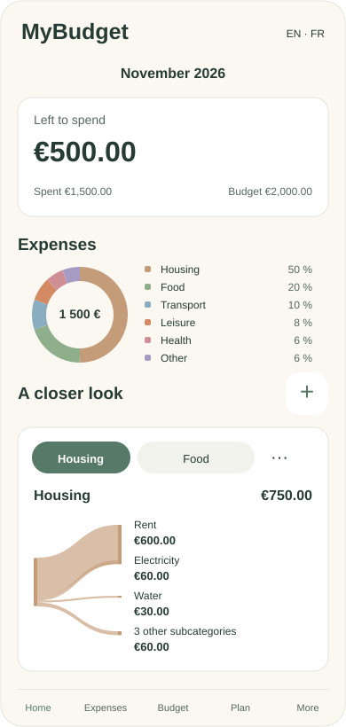
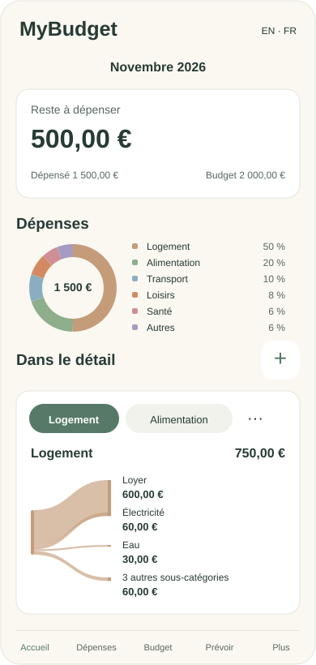
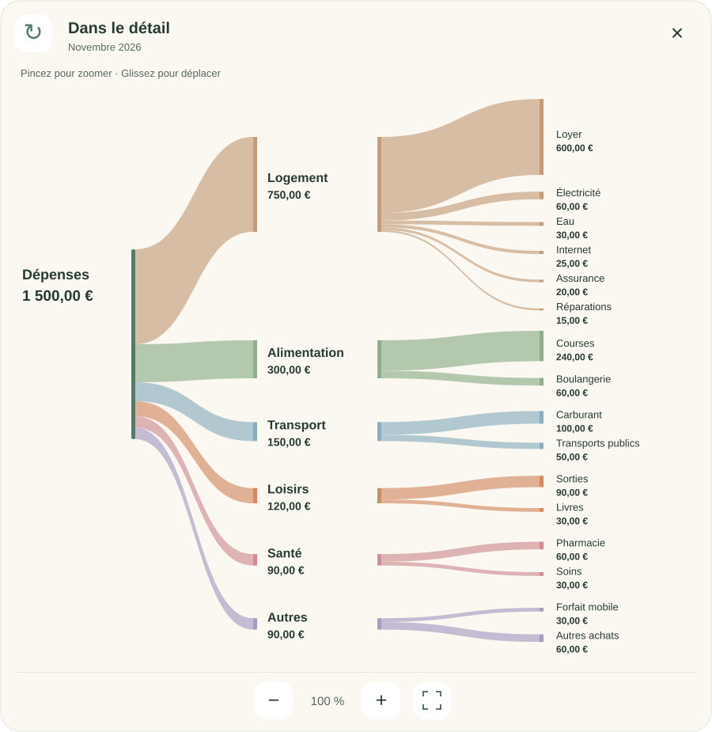

<p align="center">English · <a href="#francais">Français ↓</a></p>

<p align="center">
  
</p>

<p align="center">
  <strong>Your budget. Your phone. Your data.</strong><br />
  Expenses, income and plans, offline. Interface in English or French; amounts in euros.
</p>

<p align="center">
  <a href="https://github.com/Azouriss/MyBudget/releases"><strong>Download the Android APK</strong></a> ·
  <a href="versions/frontend/VERSION.md">Source v0.12.0.0</a> ·
  <a href="LICENSE">MIT</a>
</p>

## Install

1. Open [Releases](https://github.com/Azouriss/MyBudget/releases) and download the signed **`.apk`** under **Assets**. Each published release includes its **`.sha256`** checksum.
2. Open the APK on your Android phone and allow installation from that source if prompted.
3. Open **MyBudget**. No account, subscription or developer tools are needed.

**Updating?** Install the new APK over the existing app without uninstalling it to keep your data.

Android **7.0+** (API 24), **32-bit / 64-bit ARM** in the local build configuration.
Check each release's notes for the devices actually tested and the features included in its APK.
iOS and desktop apps are not distributed; the web version is a development preview.

## A clearer view of your spending

<p align="center">
  
  
</p>
<p align="center"><sub>Illustrated SVG previews of the current source · fictional data · not screenshots.</sub></p>

| What you can do | In MyBudget |
| :--- | :--- |
| Track | Expenses, income, search, categories and subcategories. |
| Understand | Monthly overview and spending chart. Compact category details; **+** opens every branch, with rotation, pinch zoom and dragging. |
| Plan | Monthly or payday-to-payday budgets, category limits and savings goals. |
| Anticipate | Recurring expenses and income, renewals and local payday reminders on Android. |
| Organize | Entry favorites, split receipts, partial refunds and a monthly report. CSV import with preview, local rules and duplicate checks. |
| Stay in control | Local SQLite data. No account, backend, telemetry or automatic cloud backup. |

**Current source:** frontend **0.12.0.0** · documentation **0.1.4.0**.
The configured app version remains **0.1.0**; Android build numbers are managed separately.
See the [frontend](versions/frontend/VERSION.md) and [documentation](versions/docs/VERSION.md)
histories. The latest diagram changes still require a rebuilt APK and Android phone validation.

<details>
<summary><strong>Back up and restore</strong></summary>

Save a complete JSON backup from Settings before changing phones. Restoring replaces
local data after confirmation, requires a compatible data schema and disables reminders
until you enable them on the new phone. CSV is for transactions, not a full backup.
Exports are **not encrypted**: keep them private. Imports are limited to **8 MB** and
**1,000 transactions per CSV**. Uninstalling the app or clearing its data deletes
the local database; there is no automatic remote backup.

</details>

<details>
<summary><strong>Develop, test and build</strong></summary>

**Node.js ≥ 22.13 · npm**. Locked stack: **Expo 57.0.30 · React Native 0.86.3 ·
React 19.2.3 · TypeScript 5.9.3 · SQLite / Drizzle · NativeWind**.
See [package.json](package.json) and [package-lock.json](package-lock.json).

```sh
npm ci
npm run web
npm run release:check
```

The web preview has a database separate from the phone. With Windows dependencies
under WSL, run npm in Windows PowerShell. `npm start` starts Metro for native development.
A development client must include the current native modules.

```sh
npm run build:android:local
```

The local Android build uses Windows, JDK 17 and the Android SDK. It produces a signed
APK in `dist/`. Keep `credentials.json`, `signing/` and the signing key private.
For updates, retain the package ID and signing key, increase the internal build number,
and test installation over the previous APK with data retained. Attach the signed APK
and its `.sha256` to every published release. Web checks do not replace phone testing.

</details>

## License and security

Code, original design and artwork: [MIT](LICENSE). Forks may reuse or change the design.
[Third-party notices](THIRD_PARTY_NOTICES.md) cover fonts, icons and dependencies.
Report vulnerabilities privately using [SECURITY.md](SECURITY.md).

<a id="francais"></a>
<details>
<summary><strong>🇫🇷 Français — cliquer pour ouvrir</strong></summary>

## MyBudget

**Votre budget, sur votre téléphone Android. Vos données restent chez vous.**
Dépenses, revenus et projets, hors ligne. Interface en français ou en anglais ; montants en euros.

**[Télécharger l’APK Android](https://github.com/Azouriss/MyBudget/releases)** ·
[Code v0.12.0.0](versions/frontend/VERSION.md) · [Licence MIT](LICENSE)

### Installer

1. Ouvrir les [Releases](https://github.com/Azouriss/MyBudget/releases) et télécharger l’**APK signé** dans **Assets**. Chaque release publiée contient aussi son empreinte **`.sha256`**.
2. Ouvrir l’APK sur le téléphone et autoriser l’installation depuis cette source si Android le demande.
3. Lancer **MyBudget**. Aucun compte, abonnement ou outil de développement n’est nécessaire.

**Mise à jour :** installer le nouvel APK par-dessus l’ancien, sans désinstaller, pour conserver les données.

Android **7.0+** (API 24), **ARM 32 et 64 bits** selon la configuration de compilation locale.
Consulter les notes de chaque release pour les appareils réellement testés et les fonctions de son APK.
iOS et les applications de bureau ne sont pas distribués ; le web est un aperçu de développement.

### Vos dépenses, plus lisibles

<p align="center">
  
  
</p>
<p align="center"><sub>Aperçus illustrés en SVG du code actuel · données fictives · pas des captures d’écran.</sub></p>

| Votre quotidien | Dans MyBudget |
| :--- | :--- |
| Suivre | Dépenses, revenus, recherche, catégories et sous-catégories. |
| Comprendre | Bilan mensuel et répartition des dépenses. Détail compact par catégorie ; **+** ouvre toutes les branches, avec rotation, zoom à deux doigts et déplacement. |
| Prévoir | Budgets mensuels ou de paie à paie, limites par catégorie et objectifs d’épargne. |
| Anticiper | Dépenses et revenus récurrents, renouvellements et rappels locaux du jour de paie sur Android. |
| Organiser | Favoris de saisie, tickets répartis, remboursements partiels et bilan mensuel. Import CSV avec aperçu, règles locales et contrôle des doublons. |
| Garder la main | Données SQLite locales. Aucun compte, backend, télémétrie ou sauvegarde automatique dans le cloud. |

**Code actuel :** frontend **0.12.0.0** · documentation **0.1.4.0**.
La version configurée de l’application reste **0.1.0** ; les numéros de compilation Android sont distincts.
Voir les historiques [frontend](versions/frontend/VERSION.md) et [documentation](versions/docs/VERSION.md).
Les nouveautés du diagramme nécessitent encore un nouvel APK et une recette sur téléphone Android.

### Sauvegarder et restaurer

Enregistrer une sauvegarde JSON complète depuis les paramètres avant de changer de téléphone.
La restauration remplace les données locales après confirmation, exige un schéma compatible
et désactive les rappels à réactiver sur le nouveau téléphone. Le CSV ne remplace pas une
sauvegarde complète. Les exports **ne sont pas chiffrés** : les conserver dans un emplacement privé.
Import : **8 Mo maximum** et **1 000 opérations par CSV**. Désinstaller l’application ou effacer
ses données supprime la base locale ; aucune sauvegarde distante automatique n’est réalisée.

### Développer, tester et compiler

**Node.js ≥ 22.13 · npm**. Versions verrouillées : **Expo 57.0.30 · React Native 0.86.3 ·
React 19.2.3 · TypeScript 5.9.3 · SQLite / Drizzle · NativeWind**.
Voir [package.json](package.json) et [package-lock.json](package-lock.json).

```sh
npm ci
npm run web
npm run release:check
```

La base de l’aperçu web est séparée de celle du téléphone. Sous WSL avec des dépendances
Windows, lancer npm depuis PowerShell Windows. `npm start` lance Metro pour le développement
natif. Le client de développement doit inclure les modules natifs actuels.

```sh
npm run build:android:local
```

La compilation locale nécessite Windows, JDK 17 et le SDK Android. L’APK signé est produit
dans `dist/`. Garder privés `credentials.json`, `signing/` et la clé de signature.
Pour une mise à jour, conserver l’identifiant Android et la clé, augmenter le numéro interne,
puis tester l’installation par-dessus l’ancien APK et la conservation des données.
Joindre l’APK signé et son `.sha256` à chaque release publiée. Les tests web ne remplacent pas la recette sur téléphone.

### Licence et sécurité

Code, design et visuels originaux sous [MIT](LICENSE). Les forks peuvent réutiliser ou modifier le design.
Les [polices, icônes et dépendances tierces](THIRD_PARTY_NOTICES.md) conservent leurs licences.
Pour signaler une vulnérabilité en privé : [SECURITY.fr.md](SECURITY.fr.md).

</details>
